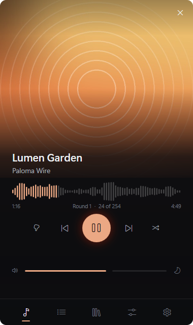
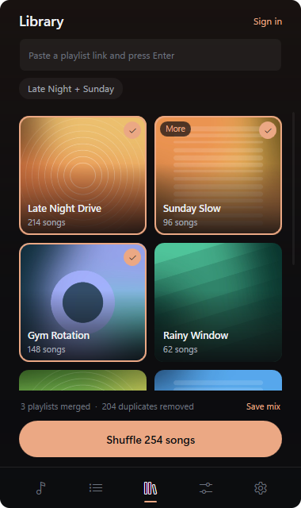
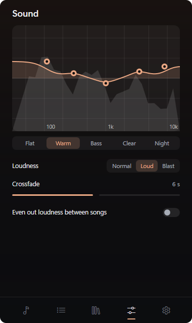
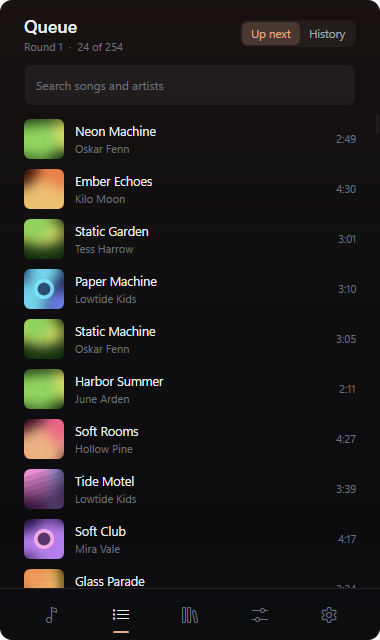

<p align="center">
  
</p>

<p align="center">
  <a href="https://github.com/slashneck/Riffle/releases/latest"></a>
  <a href="https://github.com/slashneck/Riffle/releases"></a>
  
  <a href="LICENSE"></a>
</p>

<p align="center">
  <a href="https://github.com/slashneck/Riffle/releases/latest"><b>Download for Windows</b></a>
  &nbsp;&nbsp;|&nbsp;&nbsp;
  <a href="#what-it-does">Features</a>
  &nbsp;&nbsp;|&nbsp;&nbsp;
  <a href="#privacy">Privacy</a>
  &nbsp;&nbsp;|&nbsp;&nbsp;
  <a href="#building">Build it yourself</a>
</p>

<br>

Riffle is a true shuffle for your SoundCloud. Paste your playlists, merge as many as you like, and it plays every song once, in a properly random order, from a small tile in your taskbar.

<p align="center">
  
  
  
  
</p>

<p align="center">
  
</p>

<p align="center"><sub>Pictures from version 1.0.0. Covers and song names in them are made up.</sub></p>

## What it does

- **True shuffle.** Your whole playlist, not the first few songs. Every order is equally likely and every song plays once before anything repeats.
- **Merge playlists.** Select several and they play as one. A song that's in two of them only plays once, re-uploads included.
- **Lives in the taskbar.** A tile next to the tray with the cover, the song and a level meter. Hover it for pause and next, scroll it for volume.
- **Your order, your picks.** Paste a playlist link and press Enter and it stays. Click a tile to put it in the shuffle, drag it to move it. Paste a profile link to pick from its playlists.
- **Covers that keep up.** A playlist without its own cover shows its first song's, and a new cover on SoundCloud shows up in Riffle too.
- **Sound.** A five band equalizer you drag by hand, with the music's spectrum behind it. Crossfades, and an option to even out loudness.
- **Loud without distortion.** Normal, Loud and Blast all run through a limiter, and the volume slider follows how loud it actually sounds.
- **A real queue.** Search it, play something next, and see your history.
- **Never again.** Thumbs down a song and it stays out for good.
- **Your place is kept.** Close it and pick up mid round tomorrow.
- **Other shuffle styles.** Spread artists apart, or hear what you've played least first. Give a playlist more weight if you want more of it.
- **Ultra performance.** One switch in Settings turns off covers, animations and the level meter, so it's just the music.
- Colors that follow the cover, a sleep timer, media keys and the Windows media flyout.

## Install

Download `RiffleSetup` from the [latest release](https://github.com/slashneck/Riffle/releases/latest) and run it. It installs for your account only, no admin rights needed, and shows up in Installed apps like any other program. Prefer not to install? The `win-x64` zip is the same program in a folder.

Riffle keeps itself up to date from this page. New versions download in the background and install while the music is stopped, or right away from Settings. Uninstalling removes the program and its sign-in and leaves your library in place, in case you come back.

The app and the setup aren't code signed, so Windows may warn you the first time. The checksum of each zip is on its release.

## How it plays

Riffle doesn't download or store music. It runs SoundCloud's official embedded player in the background and tells it what to play. Artists and uploaders stay credited, and every song links back to SoundCloud.

Riffle is not made by or affiliated with SoundCloud.

## Ads

"Block ads" turns away requests to known ad networks, like a browser ad blocker would. It's on by default and you can switch it off in Settings. Ads pay artists and SoundCloud, so consider SoundCloud Go if you listen a lot.

## Privacy

No telemetry and no analytics. For music Riffle only talks to SoundCloud: `soundcloud.com`, `w.soundcloud.com`, `api-widget.soundcloud.com`, `dwt.soundcloud.com`, `sndcdn.com` and `media-streaming.soundcloud.cloud`. Since the player is SoundCloud's own, SoundCloud sees what you play, like on their site.

For updates it asks `api.github.com` every few hours whether there's a new version and downloads it from `github.com`. You can switch that off in Settings.

Signing in is optional and happens on SoundCloud's own page. Riffle never sees your password. The session stays in Riffle's browser profile on your PC, and Sign out in Settings removes it.

Your library, settings and listening counts live in `%AppData%\Riffle`, and the browser profile in `%LocalAppData%\Riffle`. Song details only, never audio. If something goes wrong, the details go in `errors.log` in the same folder and stay on your PC.

## Using it

| Key | |
| --- | --- |
| Space | Play or pause |
| Left, Right | Previous or next |
| Up, Down | Volume |
| Esc | Close the window |

On the taskbar tile, click to open or close Riffle, middle click to pause, scroll for volume and right click for more. Clicking anywhere outside Riffle closes it too.

## Building

You need Windows 11 and the [.NET 8 SDK](https://dotnet.microsoft.com/download/dotnet/8.0). Playback uses the WebView2 runtime that comes with Windows 11.

```
dotnet run --project src/Riffle
```

For the setup, the zip, its checksum and a source zip in `dist\release`:

```
powershell -ExecutionPolicy Bypass -File build-release.ps1
```

## License

MIT. The music belongs to the artists.
